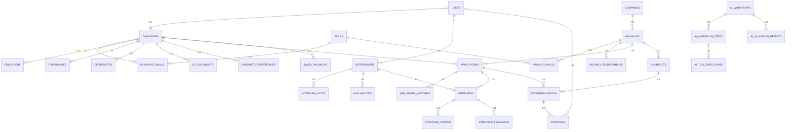

# SE3090: Software Engineering Frameworks — Assignment 1

## SkillBridge AI — Intelligent Internship & Recruitment Coordination System

---

**Module:** SE3090 Software Engineering Frameworks  
**Semester:** Year 3, Semester 2 — 2026  
**Group Members:**

| Member | Component | Domain |
| :--- | :--- | :--- |
| Member 1 | Component A | Candidate Profile & Skill Management |
| Member 2 | Component B | Vacancy & Application Management |
| Member 3 | Component C | Interview & Scheduling Management |
| Member 4: Ahamed M.N.R (IT24103157) | Component D | Shortlisting, Approval & Analytics |

**GitHub Repository:** https://github.com/RashidAhamed2004/SkillBridge  
**Live Backend API:** https://skillbridge-g6r6.onrender.com  
**Live Web App:** https://skill-bridge-eight.vercel.app  
**Live Mobile Web:** [TO BE ADDED — Netlify URL]

---

## Table of Contents

1. [System Overview](#1-system-overview)
2. [System Architecture](#2-system-architecture)
3. [Database Design](#3-database-design)
4. [Backend API Design & Implementation](#4-backend-api-design--implementation)
5. [React Web Application (Recruiter Portal)](#5-react-web-application-recruiter-portal)
6. [Flutter Mobile Application (Candidate Portal)](#6-flutter-mobile-application-candidate-portal)
7. [Agentic AI Implementation](#7-agentic-ai-implementation)
8. [Business Component Details](#8-business-component-details)
9. [Testing Strategy & Results](#9-testing-strategy--results)
10. [CI/CD Pipeline](#10-cicd-pipeline)
11. [Deployment](#11-deployment)
12. [Architecture Decision Records](#12-architecture-decision-records)
13. [Git Workflow & Version Control](#13-git-workflow--version-control)
14. [Screenshots](#14-screenshots)
15. [References](#15-references)

---

## 1. System Overview

SkillBridge AI is a full-stack, cross-platform recruitment coordination system that we built for the SE3090 assignment. The system helps match internship candidates with job vacancies using a four-agent AI pipeline, while keeping a human recruiter in the loop for all final decisions.

The core idea is straightforward: candidates use a Flutter mobile app to build their profiles and apply for internship vacancies, while recruiters use a React web portal to manage vacancies, review AI-generated shortlists, approve or reject candidates, schedule interviews, and view analytics. A Python-based Agentic AI service running internally behind the ASP.NET Core backend handles the automated matching, scoring, and validation.

### What the system does

- Candidates register, build their profile (skills, education, experience, CV upload), browse vacancies, and apply.
- The backend triggers the internal AI pipeline which calculates a match score based on skill overlap and produces a shortlist recommendation.
- The recommendation is paused at a mandatory Human-in-the-Loop (HITL) approval gate — the recruiter must explicitly approve, reject, or request revision.
- Approved candidates are scheduled for interviews. Interviewers score candidates on a structured rubric and submit qualitative feedback.
- Every action is recorded in an immutable audit log for traceability.

---

## 2. System Architecture

We followed the **Single Backend Rule** mandated by the assignment: both the React web app and Flutter mobile app communicate exclusively with the ASP.NET Core Web API over HTTPS with JWT Bearer authentication. Neither client ever touches the database directly or contacts the AI service.

```
┌─────────────────────┐       ┌──────────────────────┐
│   Flutter Mobile    │       │    React Web App      │
│   (Candidate App)   │       │   (Recruiter Portal)  │
└─────────┬───────────┘       └──────────┬────────────┘
          │                              │
          └──────────┬───────────────────┘
                     │ HTTPS + JWT Bearer
          ┌──────────▼───────────────────┐
          │   ASP.NET Core 8 Web API     │
          │   (Sole Public Backend)      │
          └──────┬──────────────┬────────┘
                 │              │
     ┌───────────▼───┐   ┌─────▼──────────────────┐
     │  PostgreSQL   │   │ Python AI Microservice  │
     │  (Supabase)   │   │ (FastAPI + 4 Agents)    │
     └───────────────┘   └────────────────────────-┘
```

### Technology Stack

| Layer | Technology | Version |
| :--- | :--- | :--- |
| Backend API | ASP.NET Core Web API (C#) | .NET 8.0 |
| Database | PostgreSQL via EF Core | Npgsql 8.0 |
| Web Frontend | React + TypeScript + Vite | React 19, Vite 8 |
| Mobile App | Flutter & Dart | Flutter 3.x, Dart ≥3.0 |
| Agentic AI | Python, FastAPI, LangGraph-compatible | FastAPI ≥0.109, Python 3.11+ |
| Authentication | JWT with HMAC-SHA256 signing | — |
| CI/CD | GitHub Actions | — |
| Backend Hosting | Render (Docker container) | — |
| Web Hosting | Vercel / Netlify | — |

### Why this architecture

The Single Backend approach gives us one security boundary. JWT tokens, role checks, input sanitisation, and database access all happen in one place. The AI service runs as an internal worker — it receives structured payloads from ASP.NET Core, does its analysis, and returns results. It never holds database credentials or serves client requests directly. This keeps the attack surface small and makes the system easier to reason about.

---

## 3. Database Design

Our PostgreSQL database has **30 tables** organized across the four business components plus shared identity tables. We manage the schema through EF Core migrations and have a standalone Supabase migration SQL script for cloud deployment.

### 3.1 Entity Relationship Overview

The database is divided into:

- **Shared/Identity**: `Users`, `Skills`, `Companies`
- **Component A** (7 tables): `Candidates`, `CandidateSkills`, `Educations`, `Experiences`, `Certificates`, `CVDocuments`, `CandidatePreferences`
- **Component B** (6 tables): `Vacancies`, `VacancySkills`, `VacancyRequirements`, `Applications`, `ApplicationStatusHistories`, `SavedVacancies`
- **Component C** (6 tables): `Interviewers`, `InterviewSlots`, `Availabilities`, `Interviews`, `InterviewScores`, `InterviewFeedbacks`
- **Component D** (8 tables): `Shortlists`, `Recommendations`, `Approvals`, `AIWorkflows`, `AIWorkflowSteps`, `AIToolExecutions`, `AIValidationResults`, `AuditLogs`

### 3.2 ER Diagram



### 3.3 Key Integrity Constraints

- `Users.Email` has a unique index — no duplicate accounts.
- `CandidateSkills` has a composite unique index on `(CandidateId, SkillId)` to prevent duplicate skill entries.
- `CandidatePreferences.CandidateId` is unique — one preference set per candidate.
- Cascade deletes are configured: deleting a `Candidate` removes all their skills, education, experience, certificates, CVs, and preferences. Deleting an `Interview` cascades to its scores and feedback.
- `AuditLogs` has no cascade foreign keys to preserve immutable records even if the referenced entity is later removed.

### 3.4 Database Configuration

The `ApplicationDbContext` class (EF Core) registers all 30 `DbSet<>` properties and configures relationships using Fluent API in `OnModelCreating()`. The backend supports both PostgreSQL (production via Supabase) and an InMemory fallback (local dev/viva demonstrations) — it tries connecting to PostgreSQL with 3 retries and gracefully falls back if unavailable.

---

## 4. Backend API Design & Implementation

### 4.1 Project Structure

```
backend/
├── SkillBridge.Api/
│   ├── Controllers/         # 8 API controllers
│   ├── DTOs/                # 4 DTO files (Auth, Candidate, Vacancy, ComponentD)
│   ├── Data/                # ApplicationDbContext.cs (EF Core)
│   ├── Models/              # Entities.cs (all 30 domain models)
│   ├── Services/            # Business logic services
│   ├── Migrations/          # EF Core migration history
│   ├── Program.cs           # App configuration and middleware pipeline
│   └── Dockerfile           # Multi-stage Docker build
└── SkillBridge.Tests/       # xUnit test project
    ├── UnitTests.cs          # 15+ component tests
    └── ProfileCompletenessTests.cs  # Profile evaluator tests
```

### 4.2 Layered Architecture

We followed the **Controller → Service → Repository** pattern with Dependency Injection:

- **Controllers** handle HTTP routing, model binding, and return appropriate status codes.
- **Services** contain business logic — profile completeness evaluation, eligibility checks, match score integration.
- **Data layer** uses EF Core with PostgreSQL for persistence.

Registered services in `Program.cs`:
```csharp
builder.Services.AddScoped<IJwtTokenService, JwtTokenService>();
builder.Services.AddScoped<IDbInitializer, DbInitializer>();
builder.Services.AddSingleton<IProfileCompletenessEvaluator, ProfileCompletenessEvaluator>();
builder.Services.AddScoped<ICandidateService, CandidateService>();
```

### 4.3 NuGet Packages Used

| Package | Purpose |
| :--- | :--- |
| `Microsoft.AspNetCore.Authentication.JwtBearer` | JWT token validation and role-based authorization |
| `Npgsql.EntityFrameworkCore.PostgreSQL` | PostgreSQL database provider for EF Core |
| `Microsoft.EntityFrameworkCore.Design` | EF Core migration tooling |
| `Microsoft.EntityFrameworkCore.InMemory` | InMemory database for testing and local demos |
| `Swashbuckle.AspNetCore` | Swagger/OpenAPI documentation UI |

### 4.4 Authentication & Authorization

We use JWT tokens signed with HMAC-SHA256. The `/api/auth/login` endpoint validates credentials (SHA-256 hashed passwords) and returns a signed token containing the user's `Id`, `FullName`, `Email`, and `Role` as claims. Protected endpoints use the `[Authorize(Roles = "...")]` attribute.

Four roles are supported:

| Role | Primary Client | Access |
| :--- | :--- | :--- |
| `Candidate` | Flutter Mobile | Own profile, applications, interviews, shortlists |
| `Recruiter` | React Web | Vacancy management, HITL approvals, analytics |
| `Interviewer` | React/Flutter | Availability, interview scoring, feedback |
| `Administrator` | React Web | Full system access, audit logs |

### 4.5 API Endpoints Summary

| Controller | Key Endpoints | Component |
| :--- | :--- | :--- |
| `AuthController` | `POST /api/auth/login`, `POST /api/auth/register` | Shared |
| `CandidatesController` | `GET/PUT /api/candidates/profile/{id}`, `POST /api/candidates/{id}/skills`, `POST /api/candidates/{id}/cv` | A |
| `VacanciesController` | `GET /api/vacancies`, `POST /api/vacancies`, `GET /api/vacancies/{id}` | B |
| `ApplicationsController` | `POST /api/applications`, `GET /api/applications/candidate/{id}`, `GET /api/applications/vacancy/{id}` | B |
| `InterviewsController` | `GET /api/interviews/candidate/{id}`, `POST /api/interviews/slots`, `POST /api/interviews/{id}/feedback` | C |
| `ShortlistsController` | `GET /api/shortlists/vacancy/{id}`, `POST /api/shortlists/approvals`, `GET /api/shortlists/ai-workflows`, `GET /api/shortlists/analytics` | D |
| `CompaniesController` | `GET /api/companies` | Shared |
| `SkillsController` | `GET /api/skills` | Shared |

### 4.6 Swagger Documentation

The API is self-documented using Swashbuckle. The Swagger UI is available at `/swagger` on the deployed backend, allowing interactive testing of all endpoints with JWT Bearer token authentication.

---

## 5. React Web Application (Recruiter Portal)

### 5.1 Technology & Package Dependencies

| Package | Purpose |
| :--- | :--- |
| `react` & `react-dom` (v19) | Core UI rendering with hooks |
| `react-router-dom` (v7) | Client-side routing with protected route guards |
| `lucide-react` | Modern icon library |
| `vite` & `@vitejs/plugin-react` | Build tool and dev server |
| `typescript` (v6) | Static type checking |

### 5.2 Project Structure

```
web_app/src/
├── App.tsx                  # Router setup, route guards, layout shell
├── context/AuthContext.tsx   # Global auth state (login, logout, token management)
├── services/api.ts          # Centralised API client with JWT interceptor
├── components/Sidebar.tsx   # Navigation sidebar with role-aware menu items
└── pages/
    ├── Login.tsx & Register.tsx         # Authentication screens
    ├── Dashboard.tsx                    # Recruiter overview metrics
    ├── CandidateDirectory.tsx           # Searchable candidate list with skill filters
    ├── CandidateProfile.tsx             # Full candidate CV viewer/editor
    ├── Vacancies.tsx                    # Vacancy CRUD with skill requirements
    ├── Companies.tsx                    # Employer directory
    ├── InterviewCalendar.tsx            # Interview scheduling and rubric scoring
    ├── HitlApprovalQueue.tsx            # HITL decision queue for AI recommendations
    ├── ShortlistView.tsx                # AI-generated shortlist rankings
    ├── WorkflowInspector.tsx            # Multi-agent execution trace viewer
    ├── Reports.tsx                      # Recruitment analytics charts
    ├── AuditLog.tsx                     # Immutable audit trail table
    ├── CandidateVacancies.tsx           # Candidate-facing vacancy browser (web)
    └── MyApplications.tsx               # Candidate application tracker (web)
```

### 5.3 Route Protection

We implemented role-based route guards using React components:

- `ProtectedRecruiterRoute` — blocks Candidates from recruiter-only pages, redirects unauthenticated users to login.
- `ProtectedCandidateRoute` — restricts candidate-specific pages (profile, browse vacancies, my applications) to the Candidate role.

The `AuthContext` provider wraps the entire app, stores the JWT token in `localStorage`, and exposes `loginUser()` and `logoutUser()` functions to all child components.

### 5.4 Human-in-the-Loop Approval Page

The `HitlApprovalQueue.tsx` page is one of the most important screens in the recruiter portal. It displays all AI-generated recommendations that are in `PENDING` status. For each candidate, the recruiter sees:

- The candidate name, applied vacancy, and AI-calculated match score
- A summary of matched and missing skills
- Three action buttons: **Approve**, **Reject**, or **Request Revision**
- A mandatory comments field for audit purposes

When the recruiter submits a decision, the API updates the `Approvals` table, changes the recommendation status, and creates an `AuditLog` entry.

---

## 6. Flutter Mobile Application (Candidate Portal)

### 6.1 Technology & Package Dependencies

| Package | Purpose |
| :--- | :--- |
| `provider` (v6.1.2) | Reactive state management |
| `http` (v1.2.1) | HTTP client for REST API communication |
| `flutter_secure_storage` (v9.2.2) | Encrypted JWT token storage on Android |
| `file_picker` (v8.0.0) | Native file picker for CV upload |
| `intl` (v0.19.0) | Date/time formatting for interview schedules |
| `shared_preferences` (v2.2.3) | Lightweight local preference storage |

### 6.2 Project Structure

```
mobile_app/lib/
├── main.dart                     # App entry, theme, AuthGate, tab navigation
├── providers/
│   ├── auth_provider.dart        # Login, register, token management
│   └── candidate_profile_provider.dart  # Profile state management
├── services/
│   ├── api_service.dart          # REST API communication layer
│   └── storage_service.dart      # Secure token persistence
├── models/                       # Dart data models (Vacancy, Application, etc.)
└── screens/
    ├── auth/                     # LoginScreen, RegisterScreen
    ├── vacancy_list_screen.dart  # Vacancy search with filters + Apply button
    ├── vacancy_detail_screen.dart # Vacancy details + submit application
    ├── my_applications_screen.dart # Application pipeline tracker
    ├── interview_screen.dart     # Scheduled interview viewer
    ├── shortlist_screen.dart     # AI shortlist notifications (scoped to user)
    ├── profile/                  # Profile editor with skills, education, etc.
    ├── saved_vacancies_screen.dart # Bookmarked vacancies
    ├── ai_workflow_screen.dart   # AI agent execution steps viewer
    ├── analytics_dashboard_screen.dart # Recruitment statistics
    └── audit_log_screen.dart     # Activity log viewer
```

### 6.3 Navigation Design

The app uses a persistent 5-tab `BottomNavigationBar`:

| Tab | Screen | Module |
| :--- | :--- | :--- |
| 0 | Vacancies (search & apply) | B |
| 1 | Applied (pipeline tracker) | B |
| 2 | Interviews (scheduled) | C |
| 3 | Shortlists (AI recommendations) | D |
| 4 | Profile (edit & manage) | A |

A Floating Action Button opens a bottom drawer with additional tools: Saved Vacancies, AI Workflows, Analytics Dashboard, Audit Logs, and Sign Out.

### 6.4 Authentication Flow

The `AuthGate` widget listens to `AuthProvider` state:
- On launch, it checks for a stored token and validates it.
- If unauthenticated, it renders `LoginScreen`.
- If authenticated, it renders `MainTabNavigation`.
- Sign out clears the token from secure storage and resets the `AuthProvider`, which triggers `AuthGate` to show the login screen again.

### 6.5 Theme & Accessibility

We use a Material 3 dark theme (`Color(0xFF0F172A)` background) with `Colors.indigoAccent` as the primary colour. All `ElevatedButton` widgets explicitly set `foregroundColor: Colors.white` and the global `ColorScheme` sets `onPrimary: Colors.white` to guarantee high-contrast, accessible button text on all devices.

For desktop web browsers, the app renders inside a `WebMobileShell` — a simulated smartphone frame (420×840px with rounded corners and a notch) for realistic demo presentation.

---

## 7. Agentic AI Implementation

### 7.1 Architecture

The AI service is a Python FastAPI application that operates as an internal microservice. It is called exclusively by the ASP.NET Core backend — never by React or Flutter directly.

```
ai_service/
├── app/
│   ├── main.py                        # FastAPI app, endpoints, Pydantic models
│   ├── agents/
│   │   ├── planner_agent.py           # Agent 1: Planning
│   │   ├── candidate_analysis_agent.py # Agent 2: Profile Analysis
│   │   ├── job_matching_agent.py      # Agent 3: Matching & Interview
│   │   ├── validation_fairness_agent.py # Agent 4: Validation & Fairness
│   │   └── workflow_graph.py          # LangGraph-compatible orchestrator
│   └── tools/
│       └── allowlisted_tools.py       # 12 allow-listed tools with schema validation
├── tests/
│   └── test_agents.py                 # 530-line pytest suite (golden cases + negatives)
└── requirements.txt                   # fastapi, uvicorn, pydantic, requests, pytest
```

### 7.2 The Four Agents

#### Agent 1: Planning Agent (`planner_agent.py`)
Converts a high-level recruitment objective (e.g., "Evaluate candidate for Software Engineering Intern") into a structured multi-step execution plan. It assigns each step to the appropriate downstream agent and tracks overall workflow status.

**Tools used:** `get_workflow_status()`, `delegate_task()`

#### Agent 2: Candidate Profile Analysis Agent (`candidate_analysis_agent.py`)
Builds a structured, job-relevant candidate summary from their profile data — skills with proficiency levels, education history, work experience, and CV summary. This agent deliberately excludes protected characteristics.

**Tools used:** `get_candidate_profile()`, `get_candidate_skills()`, `get_candidate_experience()`

#### Agent 3: Job Matching & Interview Agent (`job_matching_agent.py`)
Compares the candidate's skill set against the vacancy's required and preferred skills and calculates a deterministic match score (e.g., 84%). Also proposes a conflict-free interview time slot based on interviewer availability.

**Tools used:** `get_vacancy_requirements()`, `calculate_match_score()`, `get_available_interview_slots()`

#### Agent 4: Validation & Fairness Agent (`validation_fairness_agent.py`)
Runs a 4-gate validation pipeline:
1. **Eligibility Check** — verifies minimum requirements are met.
2. **Match Calculation Audit** — independently recalculates the match score to confirm Agent 3's result.
3. **Allowed Attribute Validation** — scans all data flowing through the pipeline for disallowed attributes (age, gender, race, religion, etc.) and flags any violations.
4. **HITL Routing** — if all gates pass, routes the recommendation to `PENDING_RECRUITER_APPROVAL`.

**Tools used:** `validate_eligibility()`, `validate_match_calculation()`, `validate_allowed_attributes()`, `request_approval()`

### 7.3 Workflow Graph Orchestrator

The `SkillBridgeWorkflowGraph` class implements a 4-node directed graph (LangGraph-compatible architecture):

```
plan → analyze_profile → match_jobs → validate_and_route
```

A shared `WorkflowState` dictionary is passed through all four nodes. Each node reads from and writes to this state, accumulating the full execution trace. The final output includes per-step timing, tool execution logs, and the overall recommendation.

### 7.4 Allow-Listed Tool Registry

All 12 tools are defined in `allowlisted_tools.py` with strict input/output schema validation. A key safety feature is the `_DISALLOWED_KEYS` set which rejects any data containing protected characteristics:

```python
_DISALLOWED_KEYS = frozenset(
    {"age", "gender", "race", "religion", "marital_status",
     "salary_history", "nationality", "ethnicity", "disability"}
)
```

### 7.5 AI Service Endpoints

| Method | Route | Description |
| :--- | :--- | :--- |
| `GET` | `/health` | Liveness probe — returns service status and agent list |
| `POST` | `/api/ai/workflow/execute` | Executes the full 4-agent workflow pipeline |
| `GET` | `/api/ai/workflow/{id}/status` | Queries workflow execution status |
| `POST` | `/api/ai/tools/validate` | Standalone validation tool endpoint |
| `POST` | `/api/ai/tools/match` | Standalone match score calculation endpoint |

---

## 8. Business Component Details

### 8.1 Component A — Candidate Profile & Skill Management (Member 1)

**Entities:** `Candidate`, `CandidateSkill`, `Skill`, `Education`, `Experience`, `Certificate`, `CVDocument`, `CandidatePreference`

**Key Features:**
- Full CRUD for candidate profile with phone, city, bio, LinkedIn, and portfolio URLs.
- Skill management with proficiency levels (Beginner, Intermediate, Expert) linked to a shared `Skills` taxonomy.
- Education history with institution, degree, field of study, and year range.
- Work experience with company name, job title, description, and duration.
- CV document upload with file metadata (name, size, content type).
- Career preferences (preferred location, work type, expected stipend).
- Profile completeness evaluator — a deterministic service (`ProfileCompletenessEvaluator`) that checks 6 mandatory fields and returns a percentage score.

**Branch:** `candidate-profile-management`

### 8.2 Component B — Vacancy & Application Management (Member 2)

**Entities:** `Company`, `Vacancy`, `VacancySkill`, `VacancyRequirement`, `Application`, `ApplicationStatusHistory`, `SavedVacancy`

**Key Features:**
- Vacancy creation with company assignment, title, description, location, employment type, deadline.
- Skill requirements with mandatory/preferred distinction.
- Non-negotiable eligibility requirements (text-based criteria).
- Application submission with duplicate prevention (API and database-level checks).
- Application state machine: `SUBMITTED → IN_AI_MATCHING → PENDING_RECRUITER_APPROVAL → APPROVED/REJECTED/REVISION_REQUESTED`.
- Status history tracking — every state transition is recorded with timestamp and notes.
- Vacancy bookmarking (saved vacancies) for candidates.
- Vacancy search with keyword, location, and employment type filters.

**Branch:** `vacancy-&-application-management`

### 8.3 Component C — Interview & Scheduling Management (Member 3)

**Entities:** `Interviewer`, `InterviewSlot`, `Availability`, `Interview`, `InterviewScore`, `InterviewFeedback`

**Key Features:**
- Interviewer profile linked 1:1 to a `User` account with department assignment.
- Weekly availability configuration (day of week, start/end time).
- Bookable interview slots with conflict detection.
- Interview scheduling linked to a specific `Application` and `Interviewer`.
- Structured scoring rubric — interviewers rate candidates on named metrics (e.g., "Technical Competency", "Problem Solving", "Communication") with integer scores (1–5).
- Qualitative feedback with outcome recommendation (`RECOMMEND_HIRE`, `RECOMMEND_REJECT`, etc.).
- AI-proposed interview slots based on interviewer availability and candidate preferences.

**Branch:** `Interview-&-Schduling-Management`

### 8.4 Component D — Shortlisting, Approval & Analytics (Member 4: Ahamed M.N.R - IT24103157)

**Entities:** `Shortlist`, `Recommendation`, `Approval`, `AIWorkflow`, `AIWorkflowStep`, `AIToolExecution`, `AIValidationResult`, `AuditLog`

**Key Features:**
- AI-generated shortlists grouped by vacancy.
- Recommendations with match scores, reasoning text, and status tracking.
- HITL approval workflow — recruiters approve/reject/revise each recommendation.
- Complete AI workflow execution trace — every agent step, tool invocation, input/output, and timing is persisted.
- Validation results for each workflow — eligibility, match audit, attribute checks.
- Immutable audit log recording every significant user action with entity type, entity ID, user ID, timestamp, and summary.
- Analytics dashboard with recruitment pipeline metrics.
- Reports page with charts for match score distribution and pipeline funnel.

**Branch:** `Shortlisting,-Approval-&-Analytics`

---

## 9. Testing Strategy & Results

### 9.1 Backend Tests (xUnit)

The backend test project (`SkillBridge.Tests/`) contains two test files:

**`UnitTests.cs`** — covers business logic across all four components:
- Component A: Profile completeness checks (complete profile, incomplete profile detection).
- Component B: Vacancy search filtering, pagination, application state transitions, duplicate prevention, eligibility checks, mandatory skill matching.
- Component C: Interview slot conflict detection, scoring validation.
- Component D: Match score calculation validation, HITL state transitions.

**`ProfileCompletenessTests.cs`** — dedicated tests for the `ProfileCompletenessEvaluator` service:
- 100% complete profile returns `IsComplete = true` and `CompletionPercentage = 100`.
- Missing CV returns 83% and flags CV in `MissingFields`.
- Empty profile returns 0%.
- Whitespace-only fields are correctly treated as missing.

### 9.2 Flutter Tests

The Flutter test suite (`mobile_app/test/`) contains 10 tests across 3 files:

- **`models/candidate_models_test.dart`** — tests model deserialization, proficiency label mapping, completeness parsing, education year ranges, and file size formatting.
- **`utils/validators_test.dart`** — tests form validators for email, password, phone, and URL fields.
- **`widget_test.dart`** — smoke tests ensuring the app renders `MaterialApp` without errors and shows `LoginScreen` when unauthenticated.

**Result:** All 10/10 Flutter tests pass.

### 9.3 AI Agent Tests (pytest)

The AI test suite (`ai_service/tests/test_agents.py`, 530 lines) covers:

1. **Tool-level unit tests** — tests each of the 12 allow-listed tools in isolation with known inputs.
2. **Agent-level tests** — tests each of the 4 agents with golden-case data.
3. **Golden-case end-to-end test** — a known candidate (5 skills, BSc IT, 1 year experience) matched against a known vacancy → verifies expected match score, recommendation outcome, and validation pass.
4. **Negative-case tests** — verifies that disallowed attributes (age, gender, race) are caught and rejected by the Validation & Fairness Agent.
5. **Workflow graph tests** — full end-to-end execution trace validation.

### 9.4 Test Execution

```bash
# Backend (xUnit)
dotnet test backend/SkillBridge.sln --configuration Release

# Flutter
cd mobile_app && flutter test    # 10/10 passed

# AI Service (pytest)
cd ai_service && pytest tests/ -v
```

---

## 10. CI/CD Pipeline

We set up a GitHub Actions workflow (`.github/workflows/ci.yml`) that runs automatically on every push and pull request to the `main` and `dev` branches.

### Pipeline Steps

```yaml
name: SkillBridge CI Pipeline
on:
  push:
    branches: [ main, dev ]
  pull_request:
    branches: [ main, dev ]

jobs:
  build-and-test-backend:
    runs-on: ubuntu-latest
    steps:
      - Checkout Code (actions/checkout@v4)
      - Setup .NET SDK 8.0.x (actions/setup-dotnet@v4)
      - Restore Backend Dependencies (dotnet restore)
      - Build Backend Solution (dotnet build --configuration Release)
      - Run Backend Automated Tests (dotnet test --configuration Release)
```

The pipeline ensures that every commit to `main` passes compilation and all xUnit tests before being accepted. Pull requests from feature branches must pass CI before merging.

---

## 11. Deployment

### 11.1 Backend (Render)

The ASP.NET Core API is containerised using a multi-stage Dockerfile and deployed to **Render**:

```dockerfile
# Stage 1: Build
FROM mcr.microsoft.com/dotnet/sdk:8.0 AS build
WORKDIR /src
COPY backend/SkillBridge.Api/ backend/SkillBridge.Api/
RUN dotnet publish -c Release -o /app/publish

# Stage 2: Runtime
FROM mcr.microsoft.com/dotnet/aspnet:8.0 AS runtime
COPY --from=build /app/publish .
ENTRYPOINT ["dotnet", "SkillBridge.Api.dll"]
```

The backend reads the `PORT` environment variable injected by Render and binds to `http://0.0.0.0:{PORT}`. The PostgreSQL connection string is provided via the `DATABASE_PUBLIC_URL` environment variable from Supabase.

**Live URL:** `https://skillbridge-g6r6.onrender.com`

### 11.2 Database (Supabase)

PostgreSQL is hosted on Supabase. The full schema is applied using the `supabase_migration.sql` script which creates all 30 tables, indexes, constraints, seed data, and marks the EF Core migration history as applied.

### 11.3 Web App (Vercel/Netlify)

The React web app is built with `npm run build` (Vite) and deployed as static files. The `VITE_API_BASE_URL` environment variable points to the Render backend URL.

### 11.4 Mobile App

The Flutter mobile app is compiled as:
- **Android APK** (`flutter build apk --release`) — 51.9 MB, installable via direct transfer or ADB.
- **Flutter Web** (`flutter build web --release`) — deployable to Netlify for browser-based demos.

---

## 12. Architecture Decision Records

We documented 4 Architecture Decision Records (ADRs) in `docs/adr/`:

### ADR-001: ASP.NET Core as the Sole Public Backend API
- **Decision:** All clients communicate exclusively with ASP.NET Core. The AI service and database are internal.
- **Rationale:** Single security boundary, strong typing via C#, structured DI container.

### ADR-004: JWT Role-Based Authorization
- **Decision:** Use JWT with HMAC-SHA256 for stateless authentication. Tokens carry `Role` claims and endpoints enforce `[Authorize(Roles)]`.
- **Rationale:** Works identically across React (header) and Flutter (secure storage). No server-side session store needed.

### ADR-005: Human-in-the-Loop (HITL) Approval Gate
- **Decision:** No application transitions from AI matching to approved without a recruiter's explicit action.
- **Rationale:** Eliminates fully automated high-stakes decisions. Every decision is audit-logged.

### ADR-006: Vacancy & Application State Machine
- **Decision:** Applications follow a formal state machine (`SUBMITTED → IN_AI_MATCHING → PENDING_APPROVAL → APPROVED/REJECTED/WITHDRAWN`). Every transition is recorded in `ApplicationStatusHistory`.
- **Rationale:** Prevents inconsistent states, enforces eligibility checks before AI processing, and provides full traceability.

---

## 13. Git Workflow & Version Control

### 13.1 Branching Strategy

Each team member worked on a dedicated feature branch corresponding to their component:

| Branch | Member | Component |
| :--- | :--- | :--- |
| `candidate-profile-management` | Member 1 | A — Candidate Profiles |
| `vacancy-&-application-management` | Member 2 | B — Vacancies & Applications |
| `Interview-&-Schduling-Management` | Member 3 | C — Interviews |
| `Shortlisting,-Approval-&-Analytics` | Member 4 | D — Shortlists & AI |

Feature branches were merged into `main` through Pull Requests (PRs #1–#6), each requiring review before merge.

### 13.2 Notable Commits

| Hash | Message | Significance |
| :--- | :--- | :--- |
| `93bff35` | `feat: initial SkillBridge AI project` | Project scaffold |
| `3370b8e` | `feat(vacancy-app): implement Member 2 backend, React, Flutter, tests, ADR` | Component B |
| `afd3cbf` | `feat(component-d): complete Module D — shortlists, HITL, audit, reports, 11 tests` | Component D |
| `c7e0221` | `feat(component-c): complete interview/scheduling with AI slot proposal, rubric scoring` | Component C |
| `0cfaef4` | `feat(candidate): implement candidate profile management` | Component A |
| `2e6d5f1` | `feat: implement deterministic skill-based match score calculation` | Core matching logic |
| `91581fa` | `fix(module-d): active vacancies filter, automated AI workflow, robust approvals` | D improvements |
| `94b7b65` | `fix(mobile): ensure visible white text on vacancy apply button` | Latest fix |

### 13.3 Total Commits

The repository contains approximately 49 commits across 5 branches, with 6 pull requests merged into `main`.

---

## 14. Screenshots

> [!NOTE]
> Insert screenshots of the following for the submission:

1. **React Login Screen** — [TO BE ADDED]
2. **React Dashboard** — [TO BE ADDED]
3. **React Vacancy Management** — [TO BE ADDED]
4. **React HITL Approval Queue** — [TO BE ADDED]
5. **React Interview Calendar** — [TO BE ADDED]
6. **React Shortlist View** — [TO BE ADDED]
7. **React Analytics/Reports** — [TO BE ADDED]
8. **React Audit Log** — [TO BE ADDED]
9. **Flutter Login Screen** — [TO BE ADDED]
10. **Flutter Vacancy List with Apply Button** — [TO BE ADDED]
11. **Flutter Application Pipeline** — [TO BE ADDED]
12. **Flutter Interview Screen** — [TO BE ADDED]
13. **Flutter Candidate Profile** — [TO BE ADDED]
14. **Flutter Shortlist Screen** — [TO BE ADDED]
15. **Swagger API Documentation** — [TO BE ADDED]
16. **GitHub Actions CI Pipeline (Green)** — [TO BE ADDED]
17. **Supabase Database Tables** — [TO BE ADDED]

---

## 15. References

1. Microsoft. (2024). *ASP.NET Core documentation*. https://learn.microsoft.com/aspnet/core
2. Microsoft. (2024). *Entity Framework Core documentation*. https://learn.microsoft.com/ef/core
3. Flutter. (2024). *Flutter documentation*. https://docs.flutter.dev
4. Meta. (2024). *React documentation*. https://react.dev
5. Tiangolo, S. (2024). *FastAPI documentation*. https://fastapi.tiangolo.com
6. LangChain. (2024). *LangGraph documentation*. https://langchain-ai.github.io/langgraph
7. PostgreSQL Global Development Group. (2024). *PostgreSQL documentation*. https://www.postgresql.org/docs
8. GitHub. (2024). *GitHub Actions documentation*. https://docs.github.com/actions

---

*This report was prepared by the SkillBridge AI development team for SE3090: Software Engineering Frameworks, Assignment 1, 2026.*
